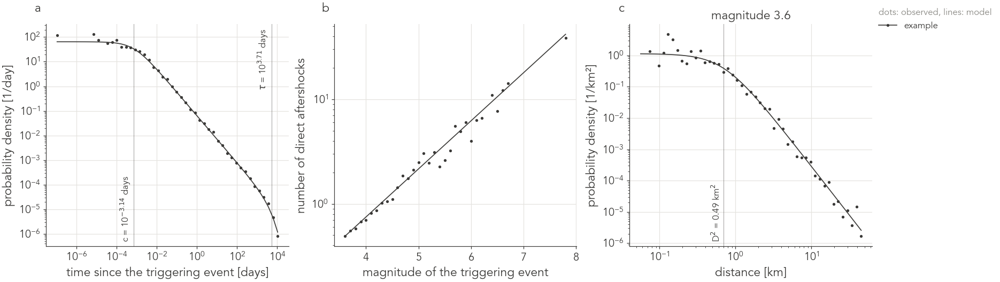
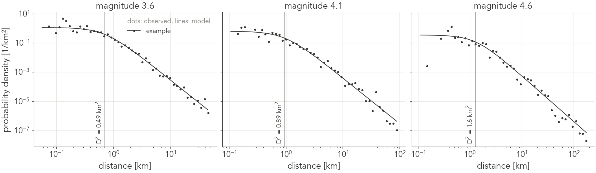
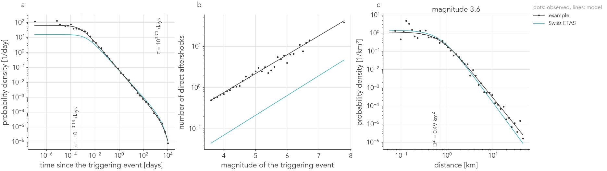
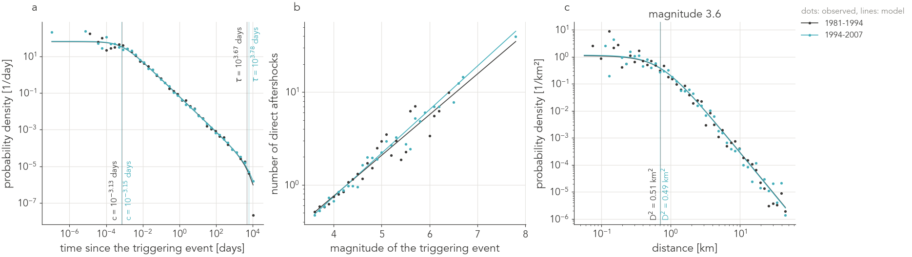

# Quickstart

The examples use the data in `input_data/` and run from the root of the
repository. The same steps exist as scripts in `runnable_code/`, configured
by the JSON files in `config/`.

## 1. Invert ETAS parameters

```python
import logging

from etas import set_up_logger
from etas.inversion import ETASParameterCalculation

set_up_logger(level=logging.INFO)

config = {
    "fn_catalog": "input_data/example_catalog.csv",
    "shape_coords": "input_data/california_shape.npy",
    "auxiliary_start": "1971-01-01 00:00:00",
    "timewindow_start": "1981-01-01 00:00:00",
    "timewindow_end": "2007-01-01 00:00:00",
    "mc": 3.6,
    "delta_m": 0.1,
    "coppersmith_multiplier": 100,
    "theta_0": {
        "log10_mu": -5.8, "log10_k0": -2.6, "a": 1.8, "log10_c": -2.5,
        "omega": -0.02, "log10_tau": 3.5, "log10_d": -0.85,
        "gamma": 1.3, "rho": 0.66,
    },
    "id": "example",
}

calculation = ETASParameterCalculation(config)
calculation.prepare()
parameters = calculation.invert()
print(parameters)

calculation.store_results("output_data/", store_pij=True)
```

The catalog is a csv file with the columns `id`, `latitude`, `longitude`,
`time`, `magnitude`; it must be complete above `mc`. Events between
`auxiliary_start` and `timewindow_start` can trigger events but are not
modeled themselves; events in the primary window
`[timewindow_start, timewindow_end)` are both. All settings are described in
[Configuration](configuration.md).

`store_results` writes `parameters_example.json` (settings and estimated
parameters) and tables of the triggering and background probabilities to
`output_data/`.

## 2. Simulate a catalog continuation (forecast)

```python
import json

from etas.inversion import ETASParameterCalculation
from etas.simulation import ETASSimulation

with open("output_data/parameters_example.json") as f:
    inversion_output = json.load(f)
calculation = ETASParameterCalculation.load_calculation(inversion_output)

simulation = ETASSimulation(calculation)
simulation.prepare()
# 10 catalogs, 30 days after timewindow_end, appended to a csv file
simulation.simulate_to_csv(
    "output_data/forecast_example.csv", forecast_n_days=30, n_simulations=10)
```

Each simulated catalog has its `catalog_id`. Many simulations together form
a probabilistic forecast.

The catalogs are independent, so they can be simulated in parallel
processes: `simulate_to_csv(..., n_jobs=8)` uses 8 processes, `n_jobs=-1`
all cores available to the program. On a cluster, reserve the cores for
the job and use at most that many; with Slurm, for example,
`#SBATCH --cpus-per-task=8` and `n_jobs=8`. If you run several forecasts
in parallel yourself, keep `n_jobs=1`.

## 3. Evaluate on a test window

```python
import json

from etas.evaluation import ETASLikelihoodCalculation

with open("output_data/parameters_example.json") as f:
    inversion_output = json.load(f)
inversion_output["testwindow_end"] = "2010-01-01 00:00:00"

evaluation = ETASLikelihoodCalculation(inversion_output)
evaluation.prepare(n=100000)
evaluation.evaluate_baseline_poisson_model()
scores = evaluation.evaluate()  # {"nll": ..., "tll": ..., "sll": ...}
```

The scores are averages over the events in the test window
`[timewindow_end, testwindow_end]`: the negative log-likelihood (`nll`) and
its temporal (`tll`) and spatial (`sll`) parts, with `-nll = tll + sll`.
The same scores of a homogeneous Poisson model are in
`evaluation.Poisson_scores`.

## 4. Plot the fit

Requires the `plot` extra. Directly after the inversion of step 1:

```python
from etas.plots import ETASFitVisualisation

visualisation = ETASFitVisualisation.from_calculation(calculation)
fig, axes = visualisation.overview("output_data/fit_overview.png")
```



The overview has three panels: (a) the time kernel, (b) the productivity
law and (c) the space kernel. Each one compares the fitted model (line)
with the "observed" branching structure, that is, all pairs of events
weighted by the probability that one triggered the other (dots). Thin
vertical lines mark the Omori offset $c$ and the taper time $\tau$ in
(a), and in (c) the size $D$ of the aftershock zone of an event of
magnitude $m$, with $D^2 = d \, e^{\gamma (m - m_{\mathrm{ref}})}$: up to
a distance of about $D$, the density is nearly flat, beyond it, it decays.
`visualisation.time_kernel_plot()`, `productivity_law_plot()` and
`space_kernel_plot()` give the single plots. Each plot takes an optional
`ax` to draw into, returns the figure and axes, and is saved only when a
file name is given. The space kernel has one panel per magnitude:



There are two ways to compare in one figure, for two different questions.

**Other parameter sets, against the data of this fit**: does the observed
branching structure of this catalog (dots) agree better with the fitted
model or with another model, for example one from another region?
`comparison_parameters` adds models given only by their parameters, as
lines without dots, each in its own colour. Each has its own reference
magnitude, which is converted to that of the fit
(`etas.plots.convert_reference_magnitude`):

```python
visualisation = ETASFitVisualisation.from_calculation(
    calculation,
    comparison_parameters={"Swiss ETAS": {
        "log10_mu": -6.19, "log10_k0": -2.71, "a": 1.42, "log10_c": -2.68,
        "omega": -0.1, "log10_tau": 3.6, "log10_d": -0.55, "gamma": 0.43,
        "rho": 0.72, "mc": 2.3, "delta_m": 0.1, "beta": 2.74}})
fig, axes = visualisation.overview()
```



**Several fits, each with its data**: how do two inversions differ, for
example of two time periods? `others` adds further fits, each with its
dots and its line in one colour; the first fit is dark gray.

```python
fits = []
for start, end in [("1981", "1994"), ("1994", "2007")]:
    period = ETASParameterCalculation(dict(
        config, id=f"{start}-{end}",
        timewindow_start=f"{start}-01-01 00:00:00",
        timewindow_end=f"{end}-01-01 00:00:00"))
    period.prepare()
    period.invert()
    fits.append(ETASFitVisualisation.from_calculation(period))

fig, axes = fits[0].overview(others=fits[1:])
```



If the reference magnitudes of the fits differ, the legend shows them: the
productivity law of each fit counts the aftershocks above its own
reference magnitude. The two can be combined; the comparison parameters
are those of the first fit.

From stored results (step 1 with `store_pij=True`):

```python
import json

from etas.plots import ETASFitVisualisation

with open("output_data/parameters_example.json") as f:
    out = json.load(f)

visualisation = ETASFitVisualisation({
    "fn_catalog": out["fn_ip"],
    "fn_pij": out["fn_pij"],
    "delta_m": out["delta_m"],
    "mc": out["m_ref"],
    "parameters": out["final_parameters"],
    "label": out["name"],
    "magnitude_list": [3.8, 4.5, 5.2],
    "store_path": "output_data/",
})
visualisation.all_plots()  # time, productivity and space fits, as pdf
```

## Other tasks

- Synthetic catalog from scratch: `etas.simulation.generate_catalog`
  (see `runnable_code/simulate_catalog.py`).
- Completeness magnitude: `etas.mc_b_est.estimate_mc`
  (see `runnable_code/estimate_mc.py`).
- Swiss catalog: `etas.download.download_catalog_sed`.
